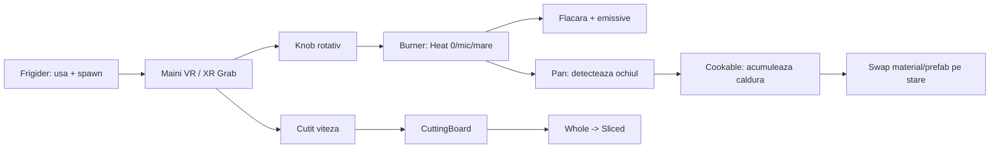

# Plan DEMO — Love at First Bite VR

**Proiect:** Love at First Bite VR
**Scop:** DEMO parțial funcțional, prezentat pe **Meta Quest 2** la facultate
**Echipă (5):** Firtescu Sebastian · Stupu Eduard · Tarca Catalin · Sescu Tiberiu · Gheoca Razvan

---

## 1. Problem Statement

Scena vizuală există (bucătărie, mâini VR, obiecte importate, câteva cu grab), dar proiectul are **zero logică de gameplay**. Pentru DEMO-ul parțial trebuie livrate mecanicile:

- apucarea obiectelor în VR;
- aprinderea aragazului cu knob (foc mic / mare);
- tăierea cărnii și a ciupercilor pe tocător (cu prag de viteză);
- punerea cărnii pe foc;
- schimbarea vizibilă a stării cărnii (Raw → Cooked → Burned) cât stă pe foc;
- luarea ingredientelor din frigider (ușă + dispenser).

**Nu intră în demo:** timer, scor, telefon, fum/alarmă, NPC.

---

## 2. Requirements (confirmate cu echipa)

| # | Decizie |
|---|---|
| Scope | Mecanicile cerute **+ bucla vizuală scurtă** (focul chiar gătește carnea prin stări). Fără timer/scor/telefon/fum/NPC. |
| Platformă | Build APK pe **Meta Quest 2**, prezentat la facultate. |
| Tăiere | Cuțit cu **prag de viteză** pe tocător → întreg devine feliat. |
| Frigider | Adăugat: ușă care se deschide + luarea ingredientelor crude. |
| Echipă | 5 persoane, taskuri paralele, integrare la final. |

---

## 3. Background (stadiul real al proiectului)

- `SampleScene.unity` conține: pereți/ușă, mâini VR, `Pan_Handle` (grab), `Knife`, `Steak`, `Plate_A/B`, `Phone`, aragaz din `Kitchen_set`.
- Pachete disponibile:
  - `GeniusCrate / Kitchen_Set` — include **`Refrigerator.fbx`**;
  - `TMI - Kitchen` — include **`fridge.obj` + `fridge_door.obj`**;
  - `Pandazole_Ultimate_Pack`, `Ultimate_Food_Pack`, `[Free] Phone`;
  - XR Interaction Toolkit 3.3.2, URP.
- **Nu există scripturi de gameplay** — doar scripturi `Editor/` pentru setup (plasare ingrediente, lighting). Folderele `Assets/Models/*` sunt goale.
- Lipsesc ca obiecte distincte: **knob-uri separate**, **ciuperci plasate**, **tocător dedicat cu trigger**, **markere pe cele 2 ochiuri**, **frigider plasat în scenă**.

---

## 4. Contracte comune (se fixează în Ziua 1, înainte de cod)

```csharp
public enum CookState { Raw, AlmostDone, Cooked, Burned }
public enum IngredientKind { Steak, Mushroom }
```

- `Burner` (pe ochi): `bool IsOn`, `float Heat` (0 = off, ~0.5 = mic, ~1 = mare).
- `Cookable` (pe ingrediente): `CookState State`, `IngredientKind Kind`, `event Action<CookState> OnStateChanged`, metodă `AddHeat(float heat, float dt)`.
- `CookingProfile` (ScriptableObject): praguri de timp per ingredient (ciupercile se ard mai repede).
- Toate scripturile în `Assets/Scripts/<Domeniu>/`.
- Logica stă în **prefab-uri**, nu în scenă → merge pe `SampleScene.unity` o singură dată, în grup.

---

## 5. Arhitectură (flux demo)



**Flux jucător:** scoate ingredientul din frigider → îl taie pe tocător (cuțit cu viteză) → pune bucata în tigaie (se atașează) → rotește knob-ul (foc mic/mare) → ochiul se aprinde → carnea trece prin stări până se arde.

---

## 6. Împărțirea taskurilor

| # | Persoană | Zonă |
|---|---|---|
| Task 1 | Firtescu Sebastian | Fundație: contracte, foldere, grab |
| Task 2 | Stupu Eduard | Knob + Burner + foc vizual |
| Task 3 | Tarca Catalin | Tigaie: contact ochi + atașare |
| Task 4 | Sescu Tiberiu | Cookable: stări de gătire |
| Task 5 | Gheoca Razvan | Tăiere cu prag de viteză |
| Task 6 | în grup (Firtescu + Gheoca) | Frigider: ușă + dispenser (extra/opțional) |
| Task 7 | toți | Integrare + build Quest 2 + demo |

---

## 7. Task Breakdown

### Task 1 — Fundație: contracte, foldere, grab pe toate obiectele (Firtescu Sebastian)

- Creează `Assets/Scripts/Common/` cu enum-urile și semnăturile din §4 + `CookingProfile` (ScriptableObject) gol cu câmpuri pentru timpi.
- Asigură `XRGrabInteractable` + `Rigidbody` + collider convex pe: tigaie, cuțit, carne, ciuperci, farfurie. Verifică `XR Interaction Manager` în scenă.
- **Test:** în XR Device Simulator ridici fiecare obiect și nu cade prin blat.
- **Demo:** apuci și muți în VR toate obiectele-cheie; proiectul compilează fără erori.

### Task 2 — Knob + Burner + foc vizual (Stupu Eduard)

- Knob-uri ca obiecte separate peste cele 2 ochiuri (din pachet sau cilindru ProBuilder).
- Script `Knob`: 3 poziții (Off / Mic / Mare), rotativ pe un ax cu `XRGrabInteractable`; **fallback** apăsare On/Off dacă rotația e greu de controlat.
- Script `Burner`: calculează `Heat` din poziția knob-ului; flacără vizibilă (particule/mesh) + emissive crescător pe ochi + haptic scurt la schimbarea poziției.
- Markere `BurnerZone_Left/Right` (empty GameObject cu trigger) pentru contactul cu tigaia.
- **Test:** knob-ul dă 3 valori de `Heat`, flacăra corespunde.
- **Demo:** rotești knob-ul pe Quest, focul se aprinde mic/mare cu reacție vizuală + haptică.

### Task 3 — Tigaie: contact cu ochi + atașare ingrediente (Tarca Catalin)

- Script `Pan`: detectează pe ce `BurnerZone` stă (trigger), expune `CurrentHeat`.
- Ingredientul aruncat în tigaie se atașează la fund (reparentare + kinematic cât e înăuntru) și se detașează la scoatere.
- Pasează `CurrentHeat` către `Cookable`-urile din tigaie prin `AddHeat()`.
- **Test:** carne în tigaie pe ochi aprins → primește căldură; pe ochi stins → nu.
- **Demo:** muți tigaia între ochi; carnea rămâne lipită și „simte" focul doar când ochiul e pornit.

### Task 4 — Cookable: stări de gătire + feedback vizual (Sescu Tiberiu)

- Script `Cookable`: acumulează căldură × timp; trece Raw → AlmostDone → Cooked → Burned cu praguri din `CookingProfile` (ciupercile mai rapide).
- La schimbarea stării, swap material URP (sau prefab) — 4 aspecte distincte (roz → maro deschis → maro închis → negru). Opțional: abur simplu la Cooked.
- Emite `OnStateChanged`.
- **Test:** cu `Heat` fix, steak-ul ajunge la Burned în timpul din profil; ciuperca mai repede.
- **Demo:** lași carnea pe foc și o vezi schimbând culoarea prin cele 4 stări în timp real.

### Task 5 — Tăiere cu prag de viteză pe tocător (Gheoca Razvan)

- Plasează un **tocător** cu collider trigger (`CuttingBoard`). Prefab-uri `Whole` și `Sliced` pentru ciupercă și carne.
- Script `Knife` (citește viteza mâinii din Rigidbody) + `Sliceable`: când cuțitul atinge `Whole` pe tocător **peste pragul de viteză**, se înlocuiește cu `Sliced` (păstrând starea de gătire). Haptic + sunet scurt opțional.
- **Test:** mișcare lentă = nimic; mișcare peste prag = feliere.
- **Demo:** pui ciuperca/carnea pe tocător și o tai cu o mișcare fermă a cuțitului.

### Task 6 — Frigider: ușă + luarea ingredientelor (în grup / Firtescu + Gheoca) — extra/opțional

- Plasează frigiderul (`Refrigerator.fbx` sau `fridge.obj` + `fridge_door.obj`) lângă zona de gătit.
- Ușă care se deschide: `XR Simple Interactable` + `HingeJoint` sau animație simplă la poke/grab.
- Script `FridgeDispenser`: la deschidere, ingredientele `Whole` (carne, ciuperci) sunt disponibile de luat din interior; opțional respawn al unei porții când locul se golește.
- **Test:** deschizi ușa, iei carnea/ciuperca cu mâna, închizi ușa.
- **Demo:** deschizi frigiderul și scoți ingredientul crud, apoi îl duci la tocător.

### Task 7 — Integrare, build Quest 2 și demo (toți, în grup)

- Merge pe `SampleScene.unity` o singură dată; plasează knob-uri, tocător, ciuperci, tigaie peste ochiuri, frigider.
- Reglează praguri în `CookingProfile` și pragul de viteză la cuțit, direct pe Quest.
- Console fără erori, build APK, test pe Quest 2 (framerate, scară, grab, haptică).
- **Checklist DoD:** scoți ingredient din frigider · tai carne + ciuperci · pui carnea în tigaie pe foc · aprinzi focul mic/mare · carnea trece prin stări.
- **Demo:** rundă completă pe Quest 2: deschide frigider → ia → taie → pune pe foc → aprinde → se gătește.

---

## 8. Riscuri și măsuri

| Risc | Măsură |
|---|---|
| Knob rotativ greu de controlat cu mâna | Fallback buton On/Off (Task 2) |
| Atașarea ingredientului în tigaie instabilă | Reparentare + kinematic (Task 3) |
| Prag de viteză la tăiere prost reglat | Calibrare pe Quest în Task 7 |
| Ușa frigiderului cu fizică instabilă | Fallback animație simplă open/close la poke (Task 6) |
| Conflicte pe `SampleScene.unity` | Logica în prefab-uri, merge o singură dată în grup |
| Timp scurt | Task 6 (frigider) e primul candidat de amânat — demo-ul rămâne valid fără el |

---

## 9. Definition of Done (DEMO)

- [ ] Toate obiectele-cheie se apucă în VR, fără a cădea prin blat.
- [ ] Knob-ul aprinde ochiul pe 2 trepte (mic/mare), cu feedback vizual + haptic.
- [ ] Tigaia primește căldură doar de la ochiul aprins pe care stă.
- [ ] Carnea și ciupercile trec prin Raw → AlmostDone → Cooked → Burned (ciupercile mai repede).
- [ ] Carnea și ciupercile se pot tăia cu cuțitul (prag de viteză).
- [ ] (Opțional) Frigiderul se deschide și de acolo se iau ingredientele crude.
- [ ] Build APK rulează pe Meta Quest 2, fără erori în Console, framerate acceptabil.
