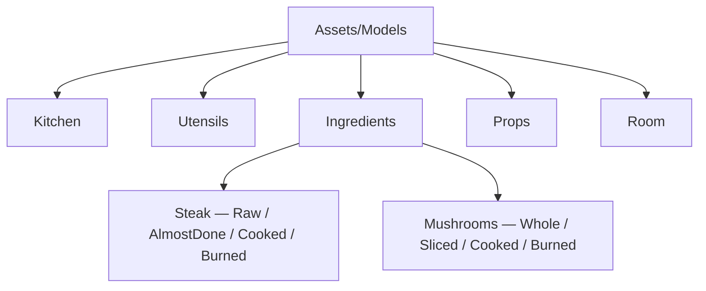
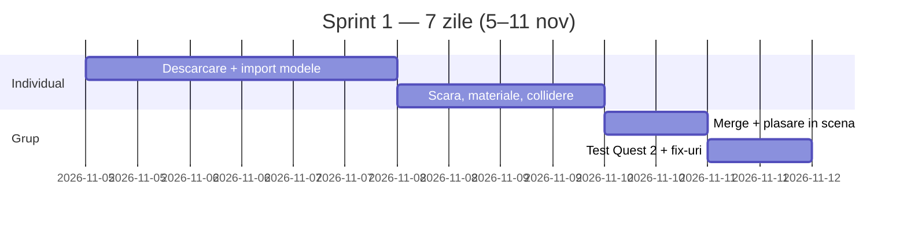
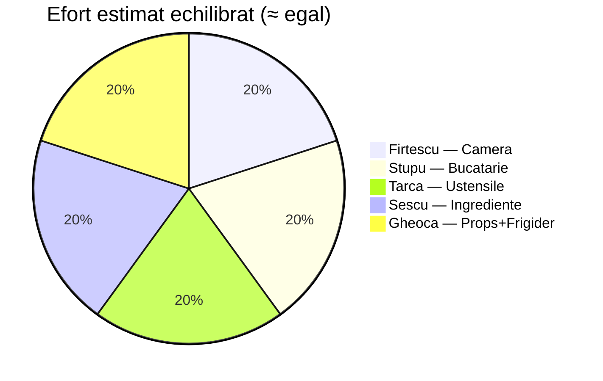

# Sprint 1 (Week 7) — Modele de bază & Scena Bucătăriei

**Proiect:** Love at First Bite VR
**Durată:** 1 săptămână (5–11 nov 2026)
**Echipă:** Firtescu Sebastian · Stupu Eduard · Tarca Catalin · Sescu Tiberiu · Gheoca Razvan

> Asseturile și sursele respectă fidel **Tema 5 → *Planning Asset Creation***. În acest sprint intră **doar modelele de bază** care fac scena jucabilă. Restul obiectelor din checklist (detector de fum, clopoțel, somon/sparanghel, al 3-lea ochi, NPC, UI, VFX, sunet) rămân pe sprinturile viitoare, odată cu logica.

---

## 1. Context

*Love at First Bite VR* este un simulator de gătit contratimp: ai 10 minute să prepari o cină de „date night" pe o plită de cămin înghesuită înainte să ajungă crush-ul, care la final te răsplătește cu un sărut sau te pedepsește cu o palmă. Mecanica centrală (sprinturile viitoare) este **multitasking-ul termic** pe 2–3 ochiuri.

Momentan scena e goală: avem doar mâinile VR riggate. Nu putem pune logica de gătit peste nimic.

## 2. Obiectivul sprintului

Construim **scheletul vizual minimal** al bucătăriei: doar obiectele de bază de care gameplay-ul va avea nevoie, cu scară corectă, materiale/texturi aplicate și — unde e cazul — `XR Grab Interactable`.

> **În acest sprint NU se implementează:** logică de gătit, timer, scor, fum/VFX, NPC, UI, sunet. Doar modele de bază, materiale, collidere și grab. Partea de gătit o lăsăm explicit pe săptămâna viitoare.

## 3. Reguli de lucru

| Regulă | Detaliu |
|---|---|
| Surse | Întâi pachetele alese în Tema 5 (vezi mai jos); altele de pe Sketchfab (CC, *Downloadable ON*) sau modelate |
| Format | FBX sau GLB (fallback: OBJ) |
| Git | Fiecare pe branch propriu → PR la final. Merge-ul scenei se face **în grup în Ziua 6** |
| Texturi | `.png`-urile stau lângă model; dacă apare roz → material non-URP sau texturi lipsă |
| Scară | Verificată în Unity față de mâinile VR încă din Ziua 1 |

### Pachete-sursă principale (din Tema 5)

| Pachet | Conține | Link |
|---|---|---|
| Pandazole Kitchen Food Low Poly | Tigăi, spatulă, tocător, farfurie, friptură raw | https://assetstore.unity.com/packages/3d/props/food/pandazole-kitchen-food-low-poly-pack-204525 |
| Ultimate Food Pack | Stările mâncării (cooked/burned), ciuperci | https://assetstore.unity.com/packages/3d/props/food/ultimate-food-pack-low-poly-3d-food-kitchen-assets-403436 |
| Free Kitchen – Cabinets and Equipment | Aragaz, dulapuri, decor | https://assetstore.unity.com/packages/3d/props/interior/free-kitchen-cabinets-and-equipment-245554 |
| Door Free Pack | Ușă de intrare + clanță | https://assetstore.unity.com/packages/3d/props/interior/door-free-pack-aferar-148411 |
| Kitchen Furniture Starter Pack | Chiuvetă + robinet | https://assetstore.unity.com/packages/3d/props/furniture/kitchen-furniture-starter-pack-209331 |
| Low Poly Household Goods | Masă, scaune | https://mastjie.itch.io/low-poly-household-goods |

### Mediu tehnic confirmat (deja în proiect)

- **XR Interaction Toolkit 3.3.2** → `XR Grab Interactable` pentru obiectele ridicabile.
- **ProBuilder 6.1.4** → room box-ul (pereți/podea/tavan) direct în Unity, fără Blender.
- **URP 17.3.0** → materialele trebuie să fie shader URP/Lit, altfel apar roz.
- **OpenXR + AI Navigation** → deja instalate pentru NPC-ul de mai târziu.

## 4. Structura de foldere

Toți o creează identic **înainte** de orice import:

```
Assets/Models/
├── Kitchen/        ← aragaz, blat, dulapuri, chiuvetă
├── Utensils/       ← tigaie, spatulă, cuțit, tocător, farfurie
├── Ingredients/
│   ├── Steak/      ← prefab Raw, AlmostDone, Cooked, Burned
│   └── Mushrooms/  ← prefab Whole, Sliced, Cooked, Burned
├── Props/          ← telefon, ceas, frigider
└── Room/           ← pereți, podea, tavan, ușă, pat, masă, scaune

Assets/Materials/
├── Kitchen/
├── Ingredients/    ← materialele pentru cele 4 stări
└── Room/
```



## 5. Planul săptămânii



- **Zilele 1–3:** fiecare importă/modelează obiectele de bază alocate pe branch propriu.
- **Zilele 4–5:** scară, materiale URP, collidere, `XR Grab Interactable`.
- **Ziua 6:** merge în grup, plasare în `SampleScene`.
- **Ziua 7:** test pe Quest 2 (sau XR Device Simulator) + fix-uri.

## 6. Împărțirea taskurilor (doar modele de bază)

Echilibrată: fiecare are **o zonă clară + același tip de muncă tehnică** (import → scară → material URP → collider/grab).

| # | Persoană | Zonă | Livrabile S1 (bază) |
|---|---|---|---|
| 1 | Firtescu Sebastian | Camera & structura | Room box (ProBuilder), ușă+clanță, pat, masă, scaune |
| 2 | Stupu Eduard | Bucătăria (zona de gătit) | Aragaz 2 ochiuri + 2 knoburi, blat, dulapuri, chiuvetă |
| 3 | Tarca Catalin | Ustensile | Tigaie, spatulă, cuțit, tocător, farfurie |
| 4 | Sescu Tiberiu | Ingrediente (4 stări) | Steak ×4 stări, Ciuperci (whole/sliced + stări) |
| 5 | Gheoca Razvan | Props & frigider | Telefon, ceas, mini-frigider, iluminare caldă |



---

### Task 1 — Camera și structura (Firtescu Sebastian)

Fundalul scenei: pereți, podea, tavan, ușă, pat, masă, scaune.

- **Room box** (pereți + podea + tavan): **ProBuilder** direct în Unity (`Tools → ProBuilder → New Shape → Cube`, scalat la o cameră mică de cămin). Fără Blender.
- **Ușa de intrare + clanța** din *Door Free Pack* — pe aici va intra NPC-ul mai târziu.
- **Masă + scaune** din *Low Poly Household Goods*.
- Lasă **spațiu liber în fața aragazului** (acolo se joacă).
- Collidere pe pereți, podea și ușă. Decorul nu are nevoie de collider acum.

**Done când:** scena are pereți/podea/tavan, ușă cu clanță, pat, masă și scaune, la scară corectă față de mâinile VR.

---

### Task 2 — Bucătăria / zona de gătit (Stupu Eduard)

Aragaz, blat, dulapuri, chiuvetă — din *Free Kitchen – Cabinets and Equipment* + *Kitchen Furniture Starter Pack*.

- Aragaz cu **2 ochiuri** (al 3-lea, pentru meniul avansat, îl lăsăm pe mai târziu).
- Marchează (empty GameObject cu nume clar) **zonele celor 2 ochiuri** — vor deveni trigger zone-uri când adăugăm logica.
- **2 knoburi**, câte unul per ochi, ca obiecte separate (din pachet sau `ProBuilder → Cylinder` aplatizat).
- Blat, dulapuri, chiuvetă+robinet.

**Done când:** aragazul (2 ochiuri marcate) + blatul + dulapurile + chiuveta sunt în scenă; cele 2 knoburi există ca obiecte separate.

---

### Task 3 — Ustensile (Tarca Catalin)

Din *Pandazole Kitchen Food Low Poly* — **toate ridicabile în VR**.

- Tigaie, spatulă, cuțit, tocător, farfurie de servire. *(Capacele și clopoțelul le lăsăm pe sprinturile cu hazard/plating.)*
- Pe fiecare: `BoxCollider` (sau MeshCollider convex) + `Rigidbody` + `XR Grab Interactable`.
- Testează cu **XR Device Simulator** că le poți apuca și că nu cad prin blat.

**Done când:** cele 5 ustensile se ridică cu mâna VR, au texturi (nu roz), și tigaia stă stabil pe aragaz.

---

### Task 4 — Ingrediente în 4 stări (Sescu Tiberiu)

Steak și ciuperci ca prefab-uri distincte pentru fiecare stare (Tema 5: *Raw → Almost Done → Cooked → Burned*).

- **Steak Raw** din *Pandazole*; Cooked/Burned din *Ultimate Food Pack*.
- Pentru stările lipsă, duplică modelul și schimbă doar materialul (URP/Lit):
  - *Raw* — roz-roșu, Smoothness 0.3
  - *Almost Done* — maro deschis
  - *Cooked* — maro închis, Smoothness 0.4
  - *Burned* — negru, Roughness 1
- **Ciuperci**: Whole + Sliced (din *Ultimate Food Pack*), cu stările de gătire.
- Salvează fiecare stare ca **prefab separat**.
- Ingredientele stau manual pe blat / în frigider. **Fără logică de gătit.**
- *(Somon + sparanghel = meniu avansat, mai târziu, nu acum.)*

**Done când:** există prefab-uri pentru cele 4 stări de steak + ciuperci (whole/sliced + stări), cu materiale vizual distincte.

---

### Task 5 — Props, frigider și iluminare (Gheoca Razvan)

Obiectele interactive de bază + atmosfera de cămin.

- **Telefon** (grab, va deveni interactiv mai târziu): `BoxCollider` + `Rigidbody` + `XR Grab Interactable`.
- **Ceas de perete**: vizibil din zona aragazului (va afișa timer-ul mai târziu).
- **Mini-frigider** cu ușă (animația ușii mai târziu; acum doar modelul, de unde se iau ingredientele).
- **Iluminare**: `Point Light` cald (~3000K); dezactivează Skybox din `Window → Rendering → Lighting`, Ambient Color maro-gri închis.
- *(Detector de fum + coș de gunoi vin mai târziu, odată cu hazardul.)*

**Done când:** telefonul se ridică cu mâna VR; ceasul și frigiderul sunt în scenă; iluminarea e caldă.

---

## 7. Definition of Done (Sprint 1)

- [ ] Cele 5 PR-uri sunt merged în branch-ul principal.
- [ ] `SampleScene` conține toate obiectele de bază ale celor 5 taskuri, plasate coerent.
- [ ] Niciun model nu apare roz/alb — toate au materiale URP și texturi.
- [ ] Toate obiectele au scară realistă față de mâinile VR.
- [ ] Ustensilele + telefonul se ridică în Play Mode.
- [ ] Scena rulează pe Quest 2 (sau XR Device Simulator) fără erori în Console.
- [ ] Scena arată a bucătărie de cămin, cu iluminare caldă.

## 8. Probleme frecvente la import

| Problemă | Soluție |
|---|---|
| Modelul apare roz / alb | Material non-URP sau texturi lipsă → URP/Lit, pune `.png`-urile lângă model, reimportează |
| Modelul e imens / minuscul | Inspector → Transform → Scale, sau Model → Scale Factor la import |
| FBX nu se importă | Export ca `.glb` sau `.obj` |
| Obiectul cade prin blat | Collider lipsă sau non-convex pe Rigidbody |
| Grab nu funcționează | Lipsește `Rigidbody` sau un `XR Interaction Manager` în scenă |
| Asset-ul nu e în pachetul din Tema 5 | Caută pe https://sketchfab.com (Downloadable ON) sau https://www.fab.com |

## 9. Riscuri

- **Scară/format incompatibil** → fiecare verifică modelul în Unity în **Ziua 1**, nu în Ziua 4.
- **Conflicte Git pe `SampleScene.unity`** → merge-ul scenei se face **o singură dată, în grup, Ziua 6**.
- **Scope creep** → tentația de a aduce deja fum/NPC/UI în S1. Nu. Respectăm roadmap-ul; S1 = doar modele de bază.

## 10. Link-uri utile

| Resursă | Link |
|---|---|
| Tema 4 (descriere proiect) | `Documentation/Tema 4_ State of the art.md` |
| Tema 5 (checklist asseturi) | `Documentation/Tema 5_ Main Modules .md` |
| Unity Asset Store — Kitchen | https://assetstore.unity.com/search#q=kitchen&orderBy=1 |
| Sketchfab — Free + Downloadable | https://sketchfab.com/search?features=downloadable&sort_by=-likeCount |
| Blender | https://www.blender.org/download/ |
