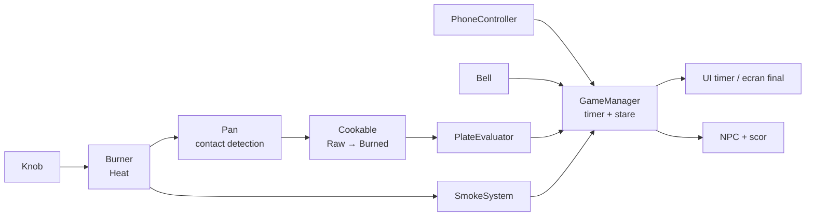
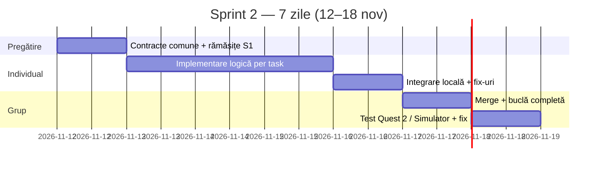
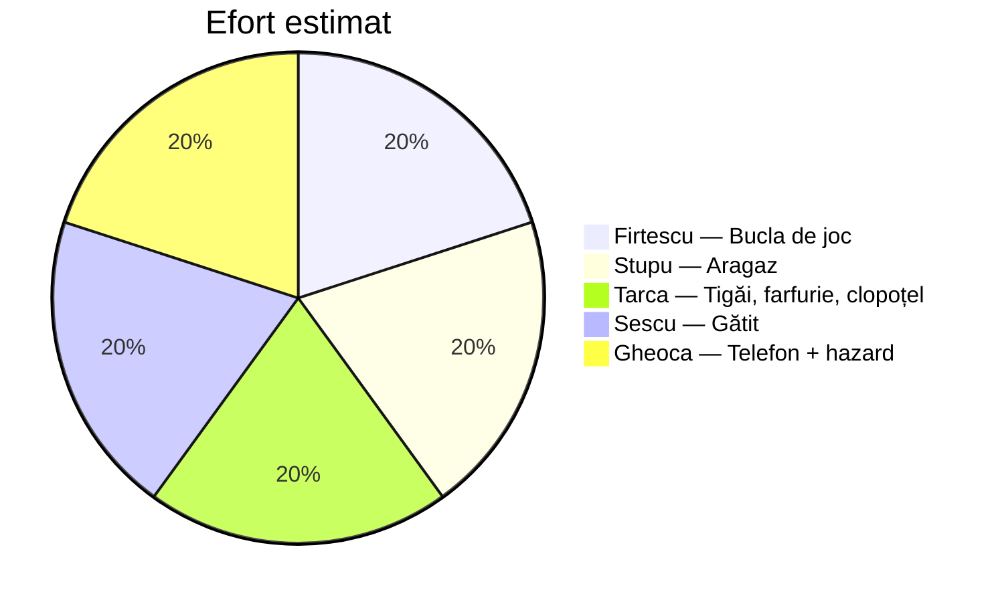

# Sprint 2 (Week 8) — Logica de gătit & bucla de joc

**Proiect:** Love at First Bite VR
**Durată:** 1 săptămână (12–18 nov 2026)
**Echipă:** Firtescu Sebastian · Stupu Eduard · Tarca Catalin · Sescu Tiberiu · Gheoca Razvan

> Sprintul 1 a livrat scena statică și obiectele ridicabile. În Sprintul 2 le facem să **funcționeze împreună**: aragaz care încălzește, mâncare care se gătește, cronometru, telefon și o evaluare finală simplă. Scopul este o **buclă de joc completă, chiar și urâtă**, de la start la scor, pe meniul simplu (steak + ciuperci, 2 ochiuri).

---

## 1. Rămășițe din Sprintul 1 (de închis în Ziua 1–2)

| Element | Responsabil | Stare |
|---|---|---|
| Reorganizarea modelelor în `Assets/Models/{Kitchen,Utensils,Props,Room}` (acum folderele sunt goale) | fiecare pentru ce a importat | de făcut |
| Merge `W7-Task4` în `main` + PR-uri pentru restul | toți | de făcut |
| Ceas de perete (vizibil din zona aragazului) | Gheoca | de făcut |
| Markere pentru cele 2 ochiuri + 2 knoburi ca obiecte separate | Stupu | de făcut |
| Test în Play Mode pe XR Device Simulator, Console fără erori | toți | de făcut |

## 2. Obiectivul sprintului

La finalul sprintului se poate juca o rundă completă:

1. Pornește cronometrul de 10 minute.
2. Jucătorul ia ingrediente din frigider, le pune în tigaie și învârte un knob.
3. Mâncarea trece prin *Raw → Almost Done → Cooked → Burned*, în funcție de timpul pe foc.
4. Telefonul vibrează și afișează mesaje.
5. Jucătorul pune mâncarea pe farfurie și apasă clopoțelul sau așteaptă expirarea timpului.
6. Un `PlateEvaluator` calculează rezultatul și se afișează un ecran de final (*Succes* sau *Eșec*).

> **Nu intră în acest sprint:** meniul avansat (somon, sparanghel, pâine cu usturoi, al 3-lea ochi), animațiile NPC-ului (kiss/slap) cu rig complet, evenimentul „bătăi în ușă”. Fum și alarmă intră doar în varianta de bază. Polish, sunet final și VFX frumoase rămân pe Sprintul 3.

## 3. Reguli de lucru

| Regulă | Detaliu |
|---|---|
| Git | Un branch per persoană. Scena `SampleScene.unity` se editează **minim**; logica stă în prefab-uri și scripturi. |
| Scripturi | `Assets/Scripts/<Domeniu>/`, un script per responsabilitate, comunicare prin evenimente C# (nu `Find` în `Update`). |
| Integrare | Merge în grup în **Ziua 6**, test în Ziua 7. |
| Interfețe comune | Stările mâncării se definesc o singură dată (vezi §4), ca să nu apară conflicte între taskuri. |

## 4. Contracte comune (se stabilesc în Ziua 1, înainte de cod)

```csharp
public enum CookState { Raw, AlmostDone, Cooked, Burned }
public enum Ingredient { Steak, Mushroom }
public enum GameResult { Win, Fail }
```

- `GameManager` expune: `TimeRemaining`, `OnGameStarted`, `OnGameEnded(GameResult)`.
- `Cookable` (pe ingrediente) expune: `CookState State`, `Ingredient Kind`, `event OnStateChanged`.
- `Burner` (pe ochi) expune: `bool IsOn`, `float Heat`.
- Pragurile de gătit se țin în `ScriptableObject` (`CookingProfile`), cu timpi diferiți: ciupercile se ard mai repede decât friptura.



## 5. Planul săptămânii



- **Ziua 1:** rămășițe S1, contractele comune (§4), structura de scripturi.
- **Zilele 2–4:** implementare pe taskuri.
- **Ziua 5:** teste individuale în scenă proprie.
- **Ziua 6:** merge în grup și bucla completă.
- **Ziua 7:** test pe Quest 2 / XR Device Simulator, bug fixing, demo.

## 6. Împărțirea taskurilor

| # | Persoană | Zonă | Livrabile S2 |
|---|---|---|---|
| 1 | Firtescu Sebastian | Bucla de joc | `GameManager`, cronometru, ceas de perete funcțional, ecran de final, scor |
| 2 | Stupu Eduard | Aragaz | Knoburi rotative, `Burner` cu 2 ochiuri, indicator vizual de căldură |
| 3 | Tarca Catalin | Tigăi & farfurie | Atașarea mâncării la tigaie, `PlateEvaluator`, transfer cu spatula/înclinare, clopoțel |
| 4 | Sescu Tiberiu | Gătit | `Cookable`, `CookingProfile`, schimbare materiale/prefab între stări, tăiatul ciupercilor pe tocător |
| 5 | Gheoca Razvan | Telefon & hazard | Telefon cu vibrație + mesaje, buton Reply, fum + alarmă (variantă de bază), coș de gunoi, frigider cu ușă |



---

### Task 1 — Bucla de joc (Firtescu Sebastian)

- `GameManager`: stări *Idle → Playing → Ended*, cronometru de 10 minute, evenimente pentru restul sistemelor.
- Pornirea rundei (buton fizic sau trigger la intrarea în zona de gătit).
- **Ceasul de perete** afișează timpul rămas (TextMeshPro, world space).
- **Ecran de final** simplu (UI world space în fața jucătorului): *Succes* sau *Eșec* plus motivul (ars, fum, mesaje ignorate, timp).
- Calculul scorului pe baza: gătire, fum, timp, mesaje.
- NPC-ul apare la final (placeholder existent), fără animații complexe.

**Done când:** o rundă pornește, numără 10 minute, se oprește și afișează un rezultat.

### Task 2 — Aragaz și knoburi (Stupu Eduard)

- Marchează cele 2 ochiuri (empty GameObjects cu trigger, `BurnerZone_Left/Right`) și separă cele 2 knoburi ca obiecte.
- Knob rotativ cu `XR Grab Interactable` cu constrângere pe un singur ax (sau apăsare pentru On/Off), cu 3 poziții: *Off / Mediu / Mare*.
- `Burner` calculează `Heat` din poziția knobului.
- Feedback vizual: inel/emissive pe ochi care se aprinde, plus haptic scurt la schimbarea pozițiilor.
- Sincronizare cu `Cookable`: tigaia primește căldura ochiului pe care stă.

**Done când:** rotind knobul, ochiul se aprinde progresiv, iar un obiect de pe el primește valoarea de căldură.

### Task 3 — Tigăi, farfurie și clopoțel (Tarca Catalin)

- **Atașare:** un `Cookable` pus în tigaie se atașează de fundul ei la contact (trigger + `FixedJoint` sau reparentare) și se detașează la scoatere.
- **PlateEvaluator** pe farfurie: citește `Cookable` de pe farfurie, verifică dacă steak-ul și ciupercile sunt prezente și în ce stare sunt.
- Transferul mâncării din tigaie pe farfurie (înclinare sau spatulă).
- **Clopoțel** de servire pe blat: apăsare fizică ⇒ încheie runda mai devreme (apelează `GameManager`).
- Recompense/penalizări: lipsește un component ⇒ penalizare; ars ⇒ penalizare mare.

**Done când:** o farfurie corectă dă *Win*, una incompletă sau arsă dă *Fail*.

### Task 4 — Gătit și stări (Sescu Tiberiu)

- `Cookable`: acumulează timp pe foc, cu praguri din `CookingProfile` (steak vs ciuperci).
- La schimbarea stării se schimbă materialul sau prefab-ul, folosind cele 4 materiale din `Assets/Materials/Ingredients/`.
- Timpi diferiți: ciupercile sunt mai rapide decât friptura.
- **Tăiere:** cuțitul pe tocător transformă `Mushroom_Whole_*` în `Mushroom_Sliced_*` (la contact cu viteză suficientă).
- Frigiderul spawnează ingrediente noi (cu Task 5), cu limită pentru reluarea unei porții.
- Eveniment `OnStateChanged` pentru restul sistemelor.

**Done când:** un steak pus pe o tigaie încinsă trece din Raw în Burned după timpul din profil, iar ciupercile întregi se pot tăia.

### Task 5 — Telefon, hazard și frigider (Gheoca Razvan)

- **Telefon:** vibrează periodic cu haptic și sunet de notificare, afișează mesaje de la NPC pe ecran (TextMeshPro), buton **Reply** (poke cu mâna) ce oprește notificările temporar și marchează mesajul ca tratat.
- **Fum și alarmă (variantă de bază):** `SmokeSystem` crește un nivel de fum când ceva arde sau stă prea mult pe foc; peste prag pornește alarma (sunet + lumină roșie intermitentă). Particule simple, fără VFX final.
- **Buton de aerisire** pe perete care scade nivelul de fum.
- **Coș de gunoi:** distruge ingredientele aruncate în el.
- **Frigider** cu ușă care se deschide și de unde se iau ingrediente noi.

**Done când:** telefonul sună și afișează mesaje, mâncarea arsă produce fum și alarmă, iar aerisirea o oprește.

---

## 7. Definition of Done (Sprint 2)

- [ ] Toate cele 5 PR-uri sunt merged în `main`, iar folderele `Assets/Models/*` sunt organizate.
- [ ] O rundă completă se poate juca de la start la ecranul de final în XR Device Simulator.
- [ ] Knoburile aprind ochiurile, iar tigaia primește căldură de la ochiul de sub ea.
- [ ] Steak-ul și ciupercile trec prin cele 4 stări în timp diferit; ciupercile pot fi tăiate.
- [ ] Telefonul vibrează, afișează mesaje și poate primi Reply.
- [ ] Fumul și alarma pornesc la mâncare arsă și se opresc cu aerisirea.
- [ ] `PlateEvaluator` și clopoțelul încheie runda cu *Succes* sau *Eșec*.
- [ ] Console fără erori în Play Mode.
- [ ] Rularea pe Quest 2 (dacă hardware-ul e disponibil), cu framerate acceptabil.

## 8. Riscuri

| Risc | Măsură |
|---|---|
| Conflicte pe `SampleScene.unity` | Logica în prefab-uri, merge scenă o singură dată în Ziua 6, anunț în grup înainte de editare |
| Interfețe diferite între taskuri (`CookState`, `Burner`) | Contractele din §4 se fixează în Ziua 1 |
| Atașarea mâncării în tigaie instabilă (fizică) | Soluție simplă: reparentare + kinematic cât timp e în tigaie |
| Knob rotativ greu de controlat cu mâna | Fallback: buton On/Off cu apăsare |
| Scope creep (meniu avansat, NPC animat, VFX) | Rămân pe Sprintul 3, conform roadmap-ului |

## 9. Sprintul 3 (preview)

Meniul avansat (somon, sparanghel, pâine cu usturoi, al 3-lea ochi), NPC-ul cu animații kiss/slap și haptic, evenimentul „bătăi în ușă”, sunet final, VFX pentru fum și foc, optimizare Quest 2 și polish.
